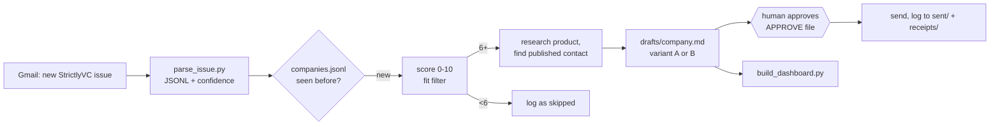

# Freshly-Funded Outreach

An agent loop that reads the StrictlyVC newsletter, picks out startups that just raised a seed or Series A round, scores them for fit, and drafts a short, specific cold email to the founder. A human approves every send. Built for a job seeker looking for a founder's-associate role at a newly funded startup.

## Why

A startup that just raised has money, a hiring list and no time to recruit. Founders at that stage still read their own inbox, and the best cold emails show that the sender actually looked at the product. The loop does the tedious part (parsing rounds, deduping, filtering, finding a contact, drafting) and leaves the judgment and the send button to a person.

## Features

- **Newsletter parser** (`scripts/parse_issue.py`): turns a StrictlyVC issue (HTML or text) into JSONL with company, amount, stage, lead investors, links, a `confidence` score and the `raw_text`, so the agent can correct anything the regex got wrong. Includes a self-test.
- **Never twice:** `ledger/seen-issues.jsonl` dedupes newsletter issues by Gmail message ID; `ledger/companies.jsonl` records every company ever seen so nobody is emailed twice.
- **Fit filter:** round size $2M–$30M, 3–30 people, sectors the sender can speak to; anything under 6/10 is logged as skipped with a reason.
- **Two email variants:** a 75–125 word direct ask, and a value-first version that leads with a short published teardown of the company's product. One follow-up template, capped at one.
- **Deliberate delay:** drafts carry a *send after* date 4–7 days past the announcement, when the founder's inbox has calmed down.
- **Guardrails:** an `APPROVE` gate file, 5 sends a day / 15 a week, at most 3 guessed addresses a day, no attachments, banned openers.
- **Dashboard** (`scripts/build_dashboard.py`): a static HTML page of drafts awaiting approval, ready-to-send items, sent mail and the company ledger.

## How it works



The parsing and dashboard are plain Python. The research and drafting are done by a coding agent (Claude Code or similar) following `AGENTS.md`, run on a schedule a few times each weekday morning. Gmail access in the original setup used the `gws` CLI; any way of exporting the issue as text works.

## Tech stack

Python 3.9+ standard library, Markdown templates, a scheduled LLM coding agent for research and drafting.

## Getting started

```sh
python3 scripts/parse_issue.py --self-test        # parser check against the built-in sample
python3 scripts/parse_issue.py issue.txt          # parse a saved issue
python3 scripts/build_dashboard.py                # writes dashboard/index.html from drafts/ and ledger/
open dashboard/index.html
```

To run the loop:

1. `cp profile/profile.example.md profile/profile.md` and replace it with your own facts.
2. Clear the fictional rows in `ledger/companies.jsonl`, `ledger/seen-issues.jsonl` and `drafts/`.
3. Point your agent at `AGENTS.md` and schedule it (cron, launchd, or an agent loop runner).
4. Read the drafts. Create an `APPROVE` file only when you want sends to go out.

No API keys are needed for the scripts. The agent needs whatever mail access you give it.

## Project structure

```
AGENTS.md              rules and the per-pass procedure for the agent
scripts/
  parse_issue.py       newsletter issue -> JSONL funding entries
  build_dashboard.py   drafts/ + sent/ + ledger/ -> dashboard/index.html
templates/             variant A (direct), variant B (value-first), follow-up
profile/               profile.example.md, the only source of claims in emails
ledger/                seen-issues.jsonl and companies.jsonl (fictional sample rows)
drafts/                one Markdown draft per company (fictional example included)
sent/, receipts/       what went out, and proof of each send (git-ignored)
dashboard/             generated HTML (git-ignored)
```

## Status

Used by the author in summer 2026 with the gate on: a handful of drafts were approved and sent. The parser was written before a large sample of real issues had arrived, which is why every entry carries `raw_text` for the agent to check. The data in this repo is fictional.

Built by [Ian Royes](https://github.com/ianroyes-sys)
